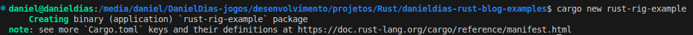
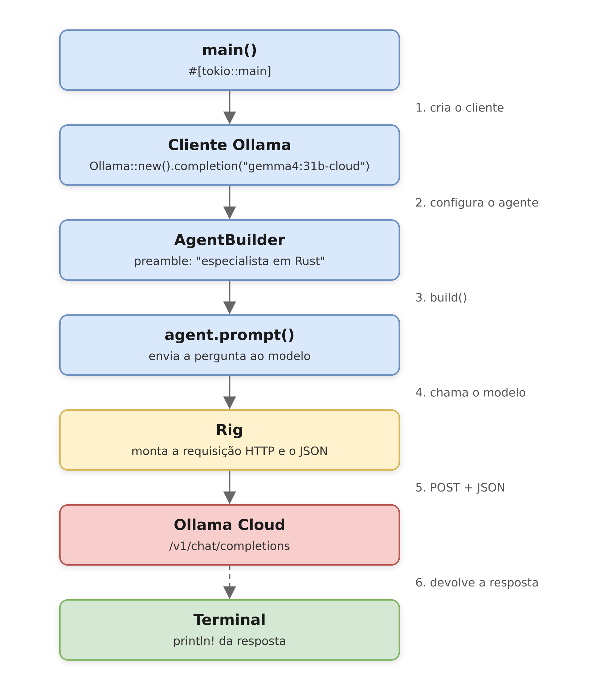
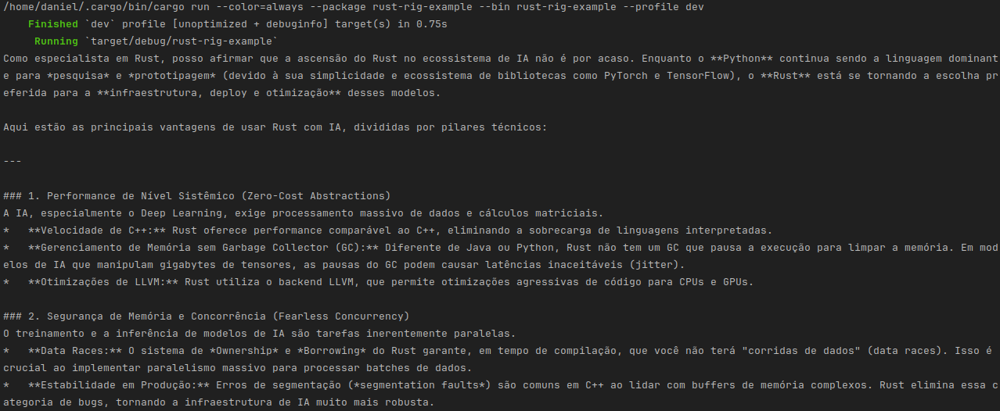
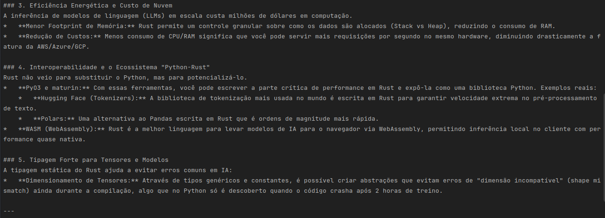
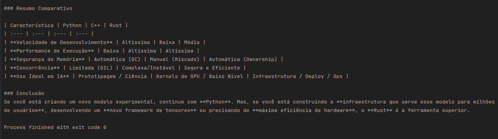
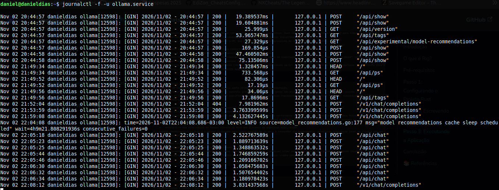

## Introdução

Eu usualmente trabalho com Java e Go, mas às vezes estudo Rust por curiosidade. Frequentemente vejo muitas aplicações e suas integrações de IA usando Java com frameworks como Spring AI ou LangChain4j. Embora sejam ótimos, eu queria explorar como o ecossistema Rust lida com o boom dos LLMs com suas promessas de segurança e desempenho.

Então eu comecei a pesquisar e descobri um framework fantástico em Rust chamado **Rig**. Ele torna a interação com LLMs incrivelmente intuitiva, aproximando a experiência do desenvolvedor do que vemos em outros SDKs de IA maduros.

então, o propósito deste artigo é criar um exemplo simples de um aplicativo em Rust que se conecta ao **Ollama Cloud** usando uma sessão autenticada via `ollama signin`.

vamos explorar juntos como construir uma aplicação Rust que interage com LLMs de forma eficiente e segura.

<!-- truncate -->

## O que é Rig?

Se você já tentou construir aplicações de IA em linguagens como Python/Java, provavelmente ouviu falar do LangChain ou de frameworks similares. Eles são frameworks que lidam com o "trabalho pesado" de conectar seu código a um modelo de IA, gerenciar prompts e lidar com contextos conversacionais.

Rig é essencialmente isso, mas construído do zero para Rust.

É uma estrutura leve e de código aberto desenvolvida pelo Playground que abstrai todas as solicitações HTTP complexas e a análise JSON que você normalmente teria que escrever à mão. Em vez de lutar com cargas úteis de API bruta, a Rig oferece uma maneira limpa e segura de:

• Chame LLMs com comandos simples.

• Crie agentes de IA que podem usar ferramentas e executar código.

• Implemente o RAG (Retrieval-Augmented Generation) para dar acesso à IA aos seus documentos privados.

Em suma, ele lida com a infraestrutura chata para que você possa se concentrar na construção do seu aplicativo.

## Pré-requisitos

Para começar, você precisará autenticar seu ambiente local executando [`ollama signin`](https://docs.ollama.com/api/authentication#signing-in) e fornecendo sua [chave de API](https://docs.ollama.com/api/authentication#api-keys).

e iremos usar o modelo [`GEMMA4`](https://ollama.com/library/gemma4:31b-cloud) com 31 bilhões de parâmetros na nuvem, que é um modelo LLM de código aberto, otimizado para tarefas de linguagem natural.

Isso permitirá que seu aplicativo Rust se comunique com o Ollama Cloud.

Tenha Rust e o Cargo instaladas em sua máquina. Se não o fez, pode seguir o [guia oficial de instalação do Rust](https://www.rust-lang.org/tools/install).

Alem de ter o [vs code com o Rust Analyzer](https://marketplace.visualstudio.com/items?itemName=rust-lang.rust-analyzer) instalado, para facilitar o desenvolvimento ou usar o [Rust Rover da JetBrains](https://www.jetbrains.com/pt-br/rust/), que é uma IDE completa para Rust.

## Passo 1: Configurando o Projeto Rust

Para começar, crie um novo projeto Rust usando o Cargo:

```bash showLineNumbers
cargo new rust-rig-example
cd rust-rig-example
```



e o projeto será criado com a seguinte estrutura:

``` 
rust-rig-example/
├── Cargo.toml
└── src
    └── main.rs
```

agora abra o arquivo `Cargo.toml` e adicione a dependência do Rig e do Tokio (para operações assíncronas) na seção `[dependencies]`:

```toml
[dependencies]
rig = "0.46.0"
tokio = { version = "1.54.1", features = ["rt", "rt-multi-thread", "macros"] }
anyhow = "1.0.104"
```
tokio é necessário porque o Rig utiliza operações assíncronas para se comunicar com o Ollama Cloud.
além disso, adicionamos a dependência `anyhow` para facilitar o tratamento de erros em Rust.

Feito isso, você está pronto para começar a escrever o código que interage com o Ollama Cloud usando o Rig.  :smiley:

## Passo 2: Escrevendo o Código

Aqui iremos criar um exemplo simples de uma aplicação Rust que se conecta ao Ollama Cloud e envia uma solicitação para um modelo LLM.

O diagrama abaixo resume o fluxo que vamos implementar:



Abra o arquivo `src/main.rs` e substitua o conteúdo pelo seguinte código:

```rust showLineNumbers
use rig::AgentBuilder;
use rig::providers::ollama;
use rig::providers::ollama::Ollama;

#[tokio::main]
async fn main() -> Result<(), anyhow::Error> {
    let ollama_client = Ollama::new().completion(ollama::GEMMA4.to_owned()+":31b-cloud");

    let agent = AgentBuilder::new(ollama_client)
        .preamble("você é um especialista em Rust")
        .build();

    println!(
        "{}",
        agent
            .prompt("Explique as principais vantagens em usar Rust com IA.")
            .await?
            .output()
    );

    Ok(())
}
```

Agora, vamos entender o que cada parte do código faz:

- `use rig::AgentBuilder;` e `use rig::providers::ollama;`: Importa os módulos necessários do Rig para criar um agente e se conectar ao Ollama.

- `#[tokio::main]`: Indica que a função `main` é assíncrona e será executada no contexto do runtime do Tokio.

- `let ollama_client = Ollama::new().completion(ollama::GEMMA4.to_owned() + ":31b-cloud");`: Cria um cliente Ollama configurado para usar o modelo GEMMA4 com 31 bilhões de parâmetros na nuvem. tivemos que concatenar `":31b-cloud"` ao nome do modelo para especificar a versão correta, visto que o rig não possui uma constante para essa versão específica, alem desse usar o `to_owned()` para criar uma String a partir do nome do modelo.

alem disso o `completion` no ollama_client é usado para indicar que queremos utilizar a API do Ollama compatível com OpenAI (`/v1/chat/completions`) para realizar a completude de texto com o modelo especificado.

- `let agent = AgentBuilder::new(ollama_client).preamble("você é um especialista em Rust").build();`: Cria um agente de IA com uma preâmbulo(prompt de Sistema) que define o contexto da conversa, neste caso, instruindo o modelo a se comportar como um especialista em Rust.

em seguida, o agente é usado para enviar um prompt ao modelo e imprimir a resposta no console.

## Passo 3: Executando a Aplicação

Para executar a aplicação, abra o terminal na raiz do projeto ou pela IDE e execute o seguinte comando:

```bash showLineNumbers
cargo run
```

e você verá a saída do modelo LLM respondendo à sua solicitação, explicando as vantagens de usar Rust com IA.








basta executar o comando `ollama service` para ver os modelos disponíveis e suas versões, como mostrado na imagem abaixo.



como você pode ver, é muito simples integrar LLMs em Rust usando o Rig e o Ollama Cloud. Com apenas algumas linhas de código, você pode criar agentes de IA poderosos e interativos.

## Conclusão

Com o Rig, a integração de LLMs em Rust se torna muito mais acessível e eficiente. Ele abstrai a complexidade das chamadas de API e do gerenciamento de contexto, permitindo que os desenvolvedores se concentrem na lógica de negócios e na experiência do usuário.

também é importante notar que o Rig é um projeto em constante evolução, e a comunidade Rust está cada vez mais interessada em explorar as capacidades de IA. Portanto, vale a pena acompanhar as atualizações do Rig e contribuir para o seu desenvolvimento.

finalmente, a combinação de Rust com LLMs abre novas possibilidades para aplicações de alto desempenho e seguras, tornando-se uma escolha atraente para desenvolvedores que desejam explorar o mundo da inteligência artificial.

incentivo você a experimentar o Rig e o Ollama Cloud em seus próprios projetos Rust, e explorar as capacidades de LLMs de forma segura e eficiente.

agradeço por ler este artigo e espero que ele tenha sido útil para você iniciar sua jornada com IA em Rust usando o Rig.

como próximos passos, você pode explorar a criação de agentes mais complexos, integração com outras ferramentas e até mesmo a implementação de RAG (Retrieval-Augmented Generation) para acessar documentos privados.

o codigo completo deste artigo está disponível no meu [rust-rig-example](https://github.com/Daniel-Dos/danieldias-rust-blog-examples/tree/master/rust-rig-example)

Até a próxima vez, continue explorando e aprendendo! 🚀

## 📚 Referências

- Rust Official Documentation — https://www.rust-lang.org/learn  
- The Rust Programming Language (The Book) — https://doc.rust-lang.org/book/
- Rig Site — https://rig.rs/
- Rig Documentation — https://rig.rs/docs
- Ollama Documentation — https://docs.ollama.com/api
- Ollama Site — https://ollama.com